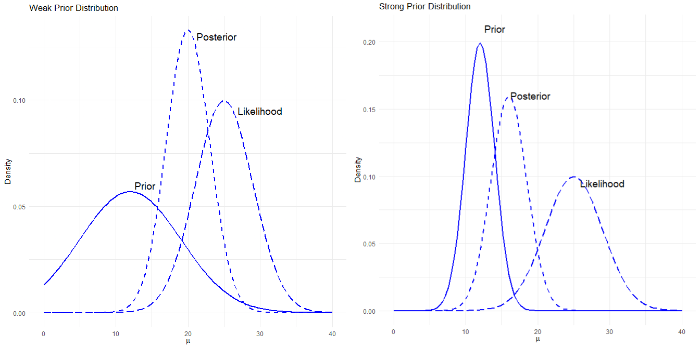
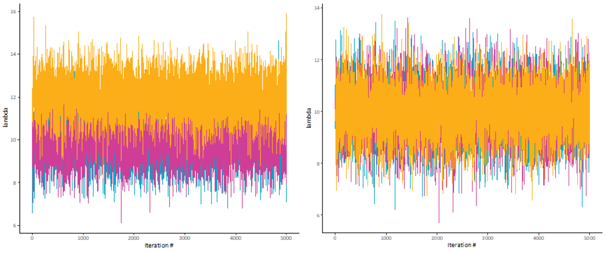

```{r include=FALSE}
library(officedown)
officedown::rdocx_document()
```

::: {custom-style="Abstract"}
**Abstract:** This paper seeks to provide a practical guide for actuaries to leverage Bayesian methods, as well as a discussion on behavioral economics as a motivating force.

**Keywords:** Bayesian Statistics, Monte Carlo, Markov Chain, MCMC, Stan, Forecasting, Predictions, Behavioral Economics, Bias
:::

\newpage

# 1. Introduction

Much has been written in the actuarial literature about Bayesian statistical methods over the last couple decades, few of which are still part of current CAS exam syllabi. While these papers provide a thorough explanation of the process, the math can seem overly complex even to an experienced actuary. The purpose of this paper is twofold. First, we want to provide property & casualty actuaries with a *basic* understanding of what goes on behind the scenes of a Bayesian model without getting bogged down in the underlying calculations. Second, we want to champion the continued inclusion of these topics on exam syllabi in the future.

While we believe this paper is beneficial to everyone in the profession, we view the following as the target audience:

-   An actuary who finished exams a few years ago and wants to ease their way into Bayesian methods.
-   An actuary who occasionally finds their estimates to be out of line with expectations, with no discernible reason.
-   An actuary who is interested in learning about Bayesian methods but finds the math too onerous or intimidating.
-   An actuary with limited data.

In Section 2, we give a brief lesson in behavioral economics and highlight potential biases that are relevant to the actuarial profession.

In Section 3, we review a few common methods of making predictions and examining their strengths and weaknesses.

In Section 4, we give a primer on the basics of Bayesian statistics and introduce Markov Chain Monte Carlo (MCMC) methods.

In Section 5, we use a real-life example to show how the underlying biases in Section 2 can impact some of the prediction methods from Section 3 and how using Bayesian methods can provide a more realistic range of reasonable estimates.

In Section 6, we provide our conclusion and the reader with additional resources to further explore these topics.

This paper was written using R Markdown. The underlying code is available as a supplementary file. Sample code for setting up a possible model is also included as a supplementary file.

# 2. A Lesson in Behavioral Economics

When making predictions, people often rely on mental operations ("heuristics"). While these may be useful from an evolutionary standpoint, they can lead to "... systematic and predictable errors". Below is a non-exhaustive list of possible factors at play when making actuarial predictions, along with key examples from *Judgment Under Uncertainty: Heuristics and Biases* (Tversky & Kahnemann).

## 2.1. Insensitivity to Sample Size

If tasked with estimating the likelihood of a particular result, people tend to base their estimate on the sample's similarity to the population's likelihood, regardless of sample size.

For example, subjects were given the following problem:

> A certain town is served by two hospitals. In the large hospital about 45 babies are born each day, and in the smaller hospital about 15 babies are born each day. As you know, about 50% of all babies are boys. The exact percentage of baby boys, however, varies from day to day. Sometimes it may be higher than 50%, sometimes lower.
>
> For a period of one year, each hospital recorded the days on which more than 60% of the babies born were boys. Which hospital do you think recorded more such days?
>
> \- The larger hospital
>
> \- The smaller hospital
>
> \- About the same (i.e., within 5% of each other)

The majority of subjects said the numbers of days would be about the same, while the minority of subjects were split evenly between the larger and smaller hospitals. According to sampling theory, there will be more such days in the smaller hospital since smaller populations generally experience more volatility.

For a more salient example, consider the actuary's task of estimating the prospective loss ratio for a given book of business when they only have two years of data. If the industry loss ratios and the company's historical loss ratios for that exposure are both consistently in the 75-80% range, one might expect the prospective loss ratio for your book and the industry to be similar. However, the volatility in loss ratios will be greater for your book than for the industry.

## 2.2. Insensitivity to the Prior Probability of Outcomes

When making a judgment of whether item X belongs to either class A or class B, people will assign it to the class in which the description of item X matches the stereotype of the class, despite the relative likelihood of each class.

For example, when subjects were tasked with evaluating the likelihood of whether a randomly sampled person out of a pool of 30 engineers and 70 lawyers was a lawyer or an engineer, subjects correctly identified the relative likelihoods (30% & 70%). However, this was not the case when subjects were also given a description of the randomly sampled person was introduced. Consider the following description:

> Dick is a 30-year old man. He is married with no children. A man of high ability and high motivation, he promises to be quite successful in his field. He is well liked by his colleagues.

When presented with this description, subjects "evaluated the likelihood that a particular description belonged to an engineer rather than to a lawyer ... with little or no regard for the prior probabilities of the two outcomes" (Tversky & Kahnemann).

When presented with the seemingly uninformative description, subjects now estimated the relative likelihoods to be equal (50% & 50%). That is, they ignored the distribution of professions from the population (30% & 70%). Even though the description offers no clue as to what profession Dick might belong to, subjects ignored the distribution of professions for the populations.

As actuaries, we often rely on industry data to help inform our selections. Suppose as part of a pricing exercise for a relatively new book of business, you see that the actual claim frequency has been exceptionally low. If you were to solely rely on that information and ignore the base rate claim frequency that generally occurs for that exposure, you would risk under-pricing the risk.

## 2.3. Misconception of Chance

People will expect even a short sample of random events to "look random." For example, when shown two sets of a random sequences of fair coin tosses, subjects will judge "HTHTTH" to be more likely than "HHHTTT", despite the two sets being equally likely.

For an example from our profession, consider the task of selecting trend rates for a company's given book of business. While we try to incorporate external information in our selections (hard versus soft market, inflation, changes in business practices, etc.), there will always be a tendency to "eyeball" trend lines - even when the data points have no clear trend. In other words, is that trendline actually increasing or are those last few points elevated merely by chance?

While we would like to think that actuaries would be immune to this particular bias, even experienced research psychologists believe they can reach a valid hypothesis by relying on small samples deemed "highly representative of the populations from which they are drawn." As a result, they "... put too much faith in the results of small samples, and grossly overestimated the replicability of such results."

## 2.4. Insensitivity to Predictive Accuracy

When making predictions, studies show that when given only a favorable or unfavorable description, subjects' predictions were "insensitive to the reliability of the description" (Tversky & Kahnemann). In other words, people tend to take a description at face value, with little regard to the credibility of the description.

Consider the following example. You are tasked with estimating the average ultimate severity of claims occurring during the upcoming policy year. The recently hired risk manager tells you that there are new post-loss measures being put in place that will reduce the potential of large claims. Taking the risk manager's assessment of the new claims handling process without support could lead to deficient estimates.

## 2.5. Regression to the Mean

If we observe a higher-than-average value sampled from a known distribution, then one might expect the next sample to be closer to average. However, studies show that many subjects do not always recognize this phenomenon. They can either fail to believe regression is applicable in their specific scenario, or they might "invent spurious causal explanations" (Tversky & Kahnemann).

In the case of forecasting losses, one might experience this phenomenon. Suppose losses are generally stable year-over-year, but the most recent year unexpectedly dropped 20% relative to the prior year. How much weight should we give this possible outlier? Do we give more weight to the longer-term average? While there is no right answer, being aware of this potential bias will allow you to make a more well-informed decision.

## 2.6. Anchoring

In one study, subjects were tasked with estimating the percentage of African countries in the United Nations. Before making their estimate, the subjects were asked to spin a wheel with numbers from 0 to 100. The subjects had to adjust upwards or downwards from this starting value. The median estimate for those with a starting value of 10 was 25%. However, for those with a starting value of 65, they had a significantly higher median estimate of 45%. This example illustrates the concept of anchoring, which is where some initial value influences the estimated value.

Suppose you're in charge of providing a loss forecast for the upcoming accident year and have been doing so for a few years. When making your selection, you are acutely aware of the estimate you provided last year (i.e., the "initial value"). This prior estimate might be "anchoring" your estimate of the prospective year. While that may not be a bad thing, issues may arise when there is insufficient adjustment to the anchoring value.

# 3. Statistical Models

## 3.1. Background

The "actuarial central estimate" is a cornerstone of our profession. It reflects the culmination of years of studying and practice. For a lot of our work, it's all that is typically required. After all, we're seen as the experts and you'd be hard-pressed to find an end user of our work that is as concerned about confidence levels as we are.

As we each have likely missed the mark on a projection at some point in our careers, it is worth reflecting on those misses. Were they due to chance (e.g., process risk), did we fail to adequately capture possible alternatives (e.g., model risk), or was there some underlying bias that caused us to see a trend that wasn't actually there? There are a lot of risks that are not captured when solely relying on point estimates. We list a few of these risks below (Venter & Sahasrabuddhe):

-   Process Risk: Inherent uncertainty of the insurance claims process.
-   Sampling Risk: Differences between observed sample and the population.
-   Data Bias: Results from incorrectly adjusting data in the experience period to be on same basis (e.g., cost level) as the exposure period.
-   Model Misspecification: The risk that one did not select the right model.
-   Insufficient Parameter Identification: Results when we fail to consider the uncertainty of our model elements.

These risks are one reason why reserving actuaries often utilize multiple methods to produce a range of reasonable estimates before selecting their point estimates.

## 3.2. Statistical Schools of Thought

Two common schools of statistical thinking are Frequentist and Bayesian.

Frequentist statistics is a type of inference that defines probability based on (as the name implies) an event's frequency from a repeatable experiment.

Bayesian statistics may sound familiar to you, as the core of Bayesian statistics is an idea called Bayes' theorem, which most actuaries would have learned in an introductory statistics course and is on the CAS Exam P/1 syllabus. We will explore Bayesian statistics further in Section 4.

Most people, and specifically actuaries, rely on frequentist statistics for their analyses. Some of the main distinctions between the two types of inference are listed below in **Table \@ref(tab:freq_vs_bayes)**:

\newpage

```{r echo=FALSE, warning=FALSE, tab.cap='Frequentist vs Bayesian', tab.cap.style = 'Table Caption', tab.id = 'freq_vs_bayes'}
flextable::regulartable(
  data = data.frame(
    'Component' = c(
      'Observed Data',
      'Parameters',
      'View on Probability',
      'Computational Burden',
      'End Result'
    ),
    Frequentist = c(
      'Repeatable and random events',
      'Fixed values',
      'Objective',
      'Minimal',
      'The probability of observing a set of events is based on a distribution and a set of defined parameters'
    ),
    Bayesian = c(
      'Known and fixed sample',
      'Random',
      'Subjective',
      'Significant',
      'Describes the parameter spaces probabilistically based on observations and prior assumptions'
    )
  ),
  cwidth = c(1.75, 2.25, 2.25)
) |> 
  flextable::border_inner() |>
  flextable::font(fontname = 'Calibri', part = 'all')
```

Upon reviewing these fundamentals, we would argue that actuarial math (as with most predictive statistics) is inherently Bayesian at its core. As actuaries, we typically know historical claim information and can say that claims and events are a known and fixed sample of observations. It is important to note that a lack of historical claims (zero observations) can also be relevant information when modeling; which is something traditional credibility theory can fail to capture.

When predicting future claims or development on claims, we don't know for certain the parameters of the future. However, given the historical information and our expertise we can describe some basis of prior assumption about the parameters. Finally, as we want to capture as much risk in our modelling as possible, a frequentist approach typically lacks parameter risk if parameters are fixed.

As such, Bayesian statistics can greatly improve actuarial models by incorporating parameter risk without really changing our view on known information. Bayesian methods allow for the incorporation of prior knowledge (or what we like to call actuarial judgement) into our prior assumptions to influence our models. Lastly, technological advances have made Bayesian modeling more accessible by minimizing computationally intensive hurdles.

# 4. Bayesian Statistical Modelling

## 4.1. Basics of Bayesian Statistics

As mentioned previously, the foundation of Bayesian statistics is Bayes' theorem. To give a brief refresher on what Bayes' theorem is: Bayes' theorem describes how to calculate an updated assumption (posterior) beginning with a prior assumption and accounting for new information provided (historical evidence). It is represented by the formula below. Starting with the traditional definition where X and Y are some events and transforming it into our context where we have some observed data and $\theta$, which represents the parameter space we intend to estimate.

$P(Y|X) = \frac{P(X|Y)}{P(X)} = \frac{f(X|Y)f(Y)}{\int_{-\infty}^{\infty} f(X|Y)f(Y)dy} = \frac{f(data|\theta)*f(\theta)}{\int f(data|\theta)*f(\theta)d\theta} = P(\theta|data)$

We can break Bayes' theorem down into 4 components:

1.  The likelihood $f(data|\theta)$ --- the probability of the data given a set of parameters
2.  The prior $f(\theta)$ --- the probability distribution of the parameters
3.  The evidence $\int f(data|\theta)*f(\theta)d\theta$ --- the likelihood of the data given all potential parameters in the distribution (*this integral can become very difficult to calculate*)
4.  The posterior $P(\theta|data)$ --- the result, which is the modified probability of the parameter space after accounting for the data.

::: {custom-style="Highlight"}
OBVIOUSLY NEEDS FINE TUNED BUT WHAT ABOUT THIS? Simply put, you start with prior (die is fair), observe some evidence (rolled two straight sixes), then form a hypothesis given the evidence to derive a likelihood function (p(6) = 40% instead of 1/6). The resulting posterior distribution is the result.
:::

A very important concept here is that applying Bayes' theorem in this way gives us probabilities of the parameter space. We do not get a result of the potential observations. Below we visualize what is happening with Baye's theorem in this context: we are producing an updated posterior, given the prior information and the likelihood.

In **Figure \@ref(fig:prior_compare)**, we see an example of the impact of a weak prior compared to a strong prior distribution on the resulting posterior distribution given the same likelihood function. Under a weak (wider variance) prior distribution, the resulting posterior distribution falls much closer to the observed likelihood of the data, allowing the data to overwhelm the prior distribution. Under a strong (tight variance) prior distribution, the resulting posterior distribution falls much closer to the prior since we are imposing a stricter belief about the parameter set and our result will in turn be much closer to that prior assumption.

```{r echo=FALSE, fig.width=6, fig.height=3, fig.cap='Weak vs Strong Prior', fig.topcaption=TRUE, fig.cap.style = 'Image Caption', fig.id='prior_compare'}

```

## 4.2. Markov Chain Monte Carlo (MCMC)

MCMC methods are an effective way of using Bayesian statistics in actuarial models. By effective, we mean that these methods can replace the need to deal with the complex integral in the denominator of Bayes' theorem. Let's start by breaking down the term Markov Chain Monte Carlo:

-   A **Markov chain** is a random process for which the future outcomes depend only on the present state.

-   **Monte Carlo** methods use random sampling to approximate an outcome.

-   Putting **Markov chain** and **Monte Carlo** methods together, **MCMC** is a way to gather a representation of the posterior distribution via simulation and repeated sampling.

It is easy to think about these two items separately, but what might an example of this look like in action? The following example attempts to describe how an MCMC process works using the Metropolis-Hastings algorithm. The Metropolis-Hastings algorithm is one of many forms of MCMC processes. Other forms include Gibbs sampling and Hamiltonian Monte Carlo, the specifics of which are beyond the scope of this paper.

Imagine there is a single frog on a pond covered in lily pads. The frog can jump from one lily pad to any of the other lily pads in the pond. The frog is more likely to jump to lily pads that are closer to it, but it can certainly hop all the way across the pond to another lily pad.

Which lily pad the frog jumps to from its current lily pad is random, but there is a higher probability that the frog jumps to a lily pad that is closer to it than one that is farther away. Essentially, the next lily pad that the frog jumps to has a distribution around it that is dependent only on the lily pad that the frog is currently on (i.e., this is a Markov chain).

Now, when the frog jumps to a new lily pad, the decision to stay on that lily pad is dependent on how much the frog likes that lily pad. The frog likes a lily pad based on how much sunlight it gets there (i.e., this is a likelihood function). If the frog doesn't like how much sunlight it gets at the new lily pad, imagine that the frog forgets that it ever jumped to it and goes back to their previous lily pad before jumping again.

It's an indecisive frog so it doesn't want to stay on the same lily pad, and so the frog will keep jumping from lily pad to lily pad (i.e., this a Monte Carlo process). At the end of the day, the frog will have spent more time on lily pads that got the most sunlight, and less time at those in the shade that weren't the right fit for the frog.

Hopefully, this is starting to paint a picture of what an MCMC process looks like and how the Markov chain and Monte Carlo simulation pieces fit together.

Extrapolating this example out to statistical terms, if we think about the lily pads as being different parameter sets, the frog jumps around from parameter set to parameter set trying to find one that fits the frog's needs well. We can think about the frog liking a certain lily pad as how well the parameter set (e.g., the given lily pad) describes the observed data (e.g., the amount of sunlight). This is just a likelihood function (i.e., what is the likelihood of the data given the parameter set). In an MCMC simulation, if that likelihood is above or below some random simulated threshold, we will accept or reject the parameter set (e.g., will the frog stay at that lily pad or go back to the one it jumped there from). Finally, if the frog continues to jump around repeatedly, we observe which lily pads the frog spends the most time on, we can end up with a distribution of which lily pads the frog liked best. In statistical terms, this equates to which parameter sets that are most likely to describe the data.

## 4.3. Execution of MCMC

MCMC can be executed using Stan, an open-source software, via common coding languages (e.g., Python and R). Later in this paper we dive into a comparison of MCMC fits versus traditional methods and provide a real example of fitting an MCMC process. In this paper, we leverage the RStan package, though there are numerous other packages that can be used (RStan leverages Hamiltonian Monte Carlo).

There are many parameters that help in the simulation process of MCMC (e.g., thinning), most of which are beyond the scope of this paper. However, two related parameters that are very important to fitting a model are iterations and chains. Iterations are simply the number of times you want the Monte Carlo process to repeat itself. Chains break up the iterations into segments. When a new chain is started, the Markov process starts from a new spot. For example, if we wanted to have 30,000 iterations, we could break the simulation up into 3 chains of 10,000 iterations each. In this example, we would have 3 random starting locations before each 10,000-iteration chain. This helps in understanding if the initial starting point influences the convergence of the chain (see discussion on anchoring above and trace plots below for more understanding).

Relating back to our frog in a pond example, breaking into chains, ensures that no matter where the frog were to start in the pond, the frog would always find its way to the sunniest parts of the pond.

In order to assess the fit of a MCMC model, there are several diagnostics you can analyze:

-   $\hat{R}$, also known as the Gelman-Rubin statistic, is a diagnostic that is used to assess the convergence of the simulation. It is calculated by comparing the variance between simulation chains to the variance within the individual chains. 
    
    The $\hat{R}$ statistic is calculated as $\scriptstyle \hat{R} = \sqrt{(\frac{N-1}{N}W+\frac{B}{W})/W}$, where $N$ is the number of iterations per chain, $W$ is the within-chain variance (measuring variance inside each individual chain), and B is the between-chain variance (measuring variance between the means of difference chains).

    A well-converging model will have an $\hat{R}$ statistic close to 1.0.

-   Effective Sample Size (N-eff) tests the correlation of the sampling done in the simulation. Since it is a Markov chain and the next iteration is dependent on the current starting position, there is going to be correlation between samples. The effective sample size statistic, $\scriptstyle ESS = n/(1 + 2*\sum_{k=1}^{\infty} \rho (k))$, helps identify how much correlation occurs during the sampling through the following formula, where $n$ is the number of iterations and $\rho (k)$ is the correlation at lag $k$.

    To think of it another way, the effective sample size is an estimation of how many ***independent*** iterations are in the simulated results, and so we want a higher effective sample size relative to the number of total iterations in the simulation. For example, if we ran a model with 10,000 iterations, an effective sample size of 7,000 could be considered a positive sign that there is low correlation in the model, and an effective sample size of 200 would indicate that there is high correlation in the model and it may not be a well fit model.

-   Trace plots show the results of the MCMC model in sequential order of the simulation. Since the output of our model is parameter estimates, we would create a trace plot for each parameter with the iteration number as the x-axis and the corresponding simulated parameter value as the y-value and draw a connecting line so we can see the path of the simulation. Ideally, we would want a trace plot to appear random, like white noise, as a sign of well-mixing models and well-converged chains. Comparing the left and right plots in **Figure \@ref(fig:trace_compare)**, the left plot is a not well-mixed model, as we see the orange line has a much higher mean across all iterations than the pink or blue lines. The plot on the right is an example of well-mixed trace plot result, the points appear random, with no specific pattern in the lines, and all 3 chains are converging over the same region.

```{r echo=FALSE, fig.width=6, fig.height=2.5, fig.cap='Bad vs Good Trace Plot', fig.topcaption=TRUE, fig.cap.style = 'Image Caption', fig.id='trace_compare'}

```

# 5. An Example in Action

For our example, let's assume you are tasked with estimating the expected frequency of global earthquakes over 6.0 magnitude for the year 2012. You are given a dataset of prior earthquakes since 1983.

First, let's get the data we'll be using in our example. **Figure \@ref(fig:data_by_year)** shows the historical frequency from 1983 to 2011.

```{r echo=FALSE, warning=FALSE, fig.width=6, fig.height=4, fig.cap='Earthquake Frequency from 1983 to 2011', fig.topcaption=TRUE, fig.cap.style = 'Image Caption', fig.id='data_by_year'}
options(scipen = 999)

data(eqlist, package = 'CASdatasets')

df <- data.table::as.data.table(eqlist)[
  mag >= 6.0, 
  .(count = .N),
  keyby = .(year = lubridate::year(day))
]

prosp_year <- 2012

counts <- df[year %in% 1983:(prosp_year - 1)]

true_count <- df[year == prosp_year, count]

point_estimate <- mean(counts[year >= prosp_year - 5, count])
subset_variance <- var(counts[year >= prosp_year - 5, count])

nb_mu <- point_estimate
nb_mu_cv <- 0.1
nb_phi <- round(point_estimate ^ 2 / (subset_variance - point_estimate), 2)

gg_orig <- ggplot2::ggplot() +
  ggplot2::scale_x_continuous(name = 'Year', breaks = seq(1983, 2023, 3)) +
  ggplot2::scale_y_continuous(name = '') +
  ggplot2::scale_color_discrete(name = '') +
  ggplot2::theme_minimal() +
  ggplot2::theme(
    legend.position = 'bottom',
    panel.grid.minor.x = ggplot2::element_blank(),
    panel.grid.minor.y = ggplot2::element_blank()
  ) +
  ggplot2::geom_col(
    data = counts,
    mapping = ggplot2::aes(
      x = year,
      y = count
    ),
    color = 'black',
    fill = 'lightgrey',
    alpha = 0.5
  ) +
  ggplot2::geom_line(
    mapping = ggplot2::aes(
      x = (prosp_year - 5):(prosp_year - 1),
      y = rep(point_estimate, 5),
      color = 'Five-Year Average'
    ),
    linetype = 'dashed',
    linewidth = 0.75
  ) +
  ggplot2::geom_hline(
    mapping = ggplot2::aes(
      yintercept = mean(counts$count),
      color = 'All-Year Average'
    ),
    linetype = 'longdash',
    linewidth = 0.75
  ) +
  ggplot2::geom_text(
    mapping = ggplot2::aes(
      x = prosp_year - 3,
      y = point_estimate,
      label = paste0('Average\n=', round(point_estimate, 1))
    ),
    vjust = -0.25,
    size = 3
  ) +
  ggplot2::geom_text(
    mapping = ggplot2::aes(
      x = 2003,
      y = mean(counts$count),
      label = paste0('Average\n=', round(mean(counts$count), 1))
    ),
    vjust = -0.25,
    size = 3
  )

gg_orig
```

In the simplest case, you may decide given the recent trend, that the eight-year average is the best approximation of future frequency. In this case, your selected frequency is `r round(point_estimate, 2)` ("Point Estimate"). This approach is consistent with the frequentist methods described earlier and can be written as follows:

$X = `r round(point_estimate, 2)`$

Your next logical step might be to add some process risk around your estimate by fitting a distribution to the data. Based on an examination of the data, you decide to model frequency using the Negative Binomial distribution with $\mu = `r nb_mu`$ and $\phi = `r nb_phi`$ (estimated via method of moments using last five years of data). This can written as follows:

$X \sim NegBin(\mu = `r nb_mu`,\ \phi = `r nb_phi`)$

```{r include=FALSE}
set.seed(314159)
iterations <- 1e5

process_risk_sample <- stats::rnbinom(n = iterations, size = nb_phi, mu = nb_mu)

process_risk <- mean(process_risk_sample)
```

After running 100,000 simulations with your selected distribution, you're left with a central estimate of `r round(process_risk, 2)`. Not surprisingly, this is essentially the same as your point estimate. However, you now have a predictive distribution. These simulations will be used later on in our comparison of methods.

Another possible step would be to layer in parameter risk since we might not be convinced of our selected parameters. You decide on letting $mu$ follow a normal distribution centered at your point estimate with a subjective range around it (coefficient of variation = `r scales::percent(nb_mu_cv)`) and decide to keep $\phi$ fixed such that the variance is maintained. This can written as follows:

$X \sim NegBin(\mu \sim Norm(mean = `r nb_mu`,\ sd = `r nb_mu * nb_mu_cv`),\ \phi = `r nb_phi`)$

```{r parameter_risk, include=FALSE}
set.seed(314159)

parameter_risk_mu <- stats::rnorm(n = iterations, mean = nb_mu, sd = nb_mu * nb_mu_cv)
parameter_risk_phi <- round(parameter_risk_mu ^ 2 / (subset_variance - parameter_risk_mu), 2)

parameter_risk_sample <- purrr::map_dbl(
  .x = 1:iterations, 
  .f = function(i) stats::rnbinom(n = 1, mu = parameter_risk_mu[i], size = parameter_risk_phi[i])
)

parameter_risk <- mean(parameter_risk_sample)
```

After running another 100,000 simulations, you're left with a central estimate of `r round(parameter_risk, 2)`. Even though we let $mu$ vary, the result is still quite close to the point estimate. This should not be surprising since that is by definition.

But as we discussed earlier, there are a few problems with just relying on our data:

-   The sample size is on the low end (n = `r nrow(counts)`).
-   How much weight do you give to recent experience?
-   It might look like there is a "new normal", but you could be seeing a trend where there isn't one.

How do we handle these possible biases? That's where Bayesian MCMC comes in. We'll continue with the distribution from our parameter risk model but now we let our data inform the simulated lambda value. In other words, if a simulated $mu$ value is deemed unlikely given our data, it will be rejected (i.e., the frog jumped back to its previous lily pad).

In addition to the prior distribution we chose for $mu$, we will assume that $phi$ follows an exponential distribution.[^1] Our Bayesian model can be written as follows:

[^1]: A detailed discussion on choosing a prior distribution for a given parameter is outside the scope of this paper. Generally, one must consider the domain of the parameter and the range of various distributions. For example, the Beta distribution, which is defined for $x \in [0,1]$, is particularly well-suited as a prior distribution for the $\theta$ parameter of a Bernoulli distribution.

$X|data \sim NegBin(\mu \sim Norm(mean = `r nb_mu`,\ sd = `r nb_mu * nb_mu_cv`),\ \phi \sim Exp(\lambda = `r round(1 / nb_phi, 4)`))$

```{r include=FALSE}
bayesian_stan_model <- rstan::stan(
  model_code = '
      data{
        int<lower = 0> N;
        array[N] int obs;
        real<lower = 0> mu_mean;
        real<lower = 0> mu_sd;
        real<lower = 0> phi_mean;
      }
      
      parameters {
        real<lower = 0> mu;
        real<lower = 0> phi;
      }
      
      model {
        mu ~ normal(mu_mean, mu_sd);
        phi ~ exponential(phi_mean); 
        
        for(i in 1:N) {
          obs[i] ~ neg_binomial_2(mu, phi);
        }
      }
    ',
  data = list(
    N = nrow(counts), 
    obs = counts$count,
    mu_mean = nb_mu,
    mu_sd = nb_mu * nb_mu_cv,
    phi_mean = 1 / nb_phi
  ),
  chains = 2,
  iter = 75000,
  warmup = 25000,
  seed = 314159
)

bayesian_mu <- rstan::extract(object = bayesian_stan_model, pars = 'mu')[[1]]
bayesian_phi <- rstan::extract(object = bayesian_stan_model, pars = 'phi')[[1]]

set.seed(314159)

bayesian_sample <- purrr::map_dbl(
  .x = 1:iterations, 
  .f = function(i) stats::rnbinom(n = 1, mu = bayesian_mu[i], size = bayesian_phi[i])
)

bayesian <- mean(bayesian_sample)
```

After running 100,000 simulations with your selected distribution, you're left with a central estimate of `r round(bayesian, 2)`. Since you used a wide prior distribution, your result will be closer to the historical average (`r round(mean(counts$count), 2)`) than the point estimate (`r round(point_estimate, 2)`).

If instead you had strong reason to believe that there would be `r round(point_estimate, 2)` earthquakes, you may opt for a "narrow" prior by letting $\mu$ have a much tighter distribution around the mean (e.g., lower coefficient of variation from `r scales::percent(nb_mu_cv)` to 1%). We'll leave this to the reader to experiment with by using the R script underlying this paper.

Let's compare each result to the true number of earthquakes that occurred in 2012, which was `r true_count`. The results are shown in **Figure \@ref(fig:compare_true)**.

```{r echo=FALSE, fig.width=6, fig.height=4, fig.cap='Distribution of Method Results', fig.topcaption=TRUE, fig.cap.style = 'Image Caption', fig.id='compare_true'}
ggplot2::ggplot() +
  ggplot2::theme_minimal() +
  ggplot2::theme(
    legend.position = 'bottom',
    panel.grid.minor.x = ggplot2::element_blank(),
    panel.grid.minor.y = ggplot2::element_blank()
  ) +
  ggplot2::scale_x_continuous(name = 'Counts') +
  ggplot2::scale_y_continuous(name = 'Cumulative Probability', labels = scales::percent) +
  ggplot2::scale_color_manual(
    name = '',
    labels = c(
      'A' = 'Actual', 
      'B' = 'Historical Counts',
      'C' = 'Point Estimate', 
      'D' = 'Process Risk', 
      'E' = 'Parameter Risk', 
      'F' = 'Bayesian'
    ),
    values = c(
      'A' = '#F59E0B',
      'B' = '#F59E0B',
      'C' = '#5D8C3C',
      'D' = '#10B981',
      'E' = '#8B5CF6',
      'F' = '#2563EB'
    )
  ) +
  # True count
  ggplot2::geom_line(
    mapping = ggplot2::aes(x = rep(true_count, 2), y = c(0, 1), group = 1, color = 'A'),
    linetype = 'solid',
    linewidth = 0.75
  ) +
  # Historical counts
  ggplot2::geom_line(
    mapping = ggplot2::aes(
      x = sort(counts$count),
      y = ecdf(counts$count)(sort(counts$count)),
      group = 1, color = 'B'
    ),
    linewidth = 0.5
  ) +
  # Point Estimate
  ggplot2::geom_line(
    mapping = ggplot2::aes(x = rep(point_estimate, 2), y = c(0, 1), group = 1, color = 'C'),
    linetype = 'dashed',
    linewidth = 0.75
  ) +
  # Process Risk
  ggplot2::geom_line(
    mapping = ggplot2::aes(
      x = sort(process_risk_sample),
      y = ecdf(process_risk_sample)(sort(process_risk_sample)),
      group = 1, color = 'D'
    ),
    linetype = 'dotted',
    linewidth = 0.75
  ) +
  # Parameter Risk
  ggplot2::geom_line(
    mapping = ggplot2::aes(
      x = sort(parameter_risk_sample),
      y = ecdf(parameter_risk_sample)(sort(parameter_risk_sample)),
      group = 1, color = 'E'
    ),
    linetype = 'dotdash',
    linewidth = 0.75
  ) +
  # Bayesian
  ggplot2::geom_line(
    mapping = ggplot2::aes(
      x = sort(bayesian_sample),
      y = ecdf(bayesian_sample)(sort(bayesian_sample)),
      group = 1, color = 'F'
    ),
    linetype = 'longdash',
    linewidth = 0.75
  )
```

It appears that all four methods severely overestimated the true average frequency. However, if we look at the Bayesian versus the other three, the true count is a more likely outcome. The true count is approximately equal to the `r scales::percent(length(bayesian_sample[bayesian_sample <= true_count]) / iterations, accuracy = 0.1)` confidence level of our Bayesian estimate, versus approximately `r scales::percent(length(parameter_risk_sample[parameter_risk_sample <= true_count]) / iterations, accuracy = 0.1)` for the process risk and and `r scales::percent(length(process_risk_sample[process_risk_sample <= true_count]) / iterations, accuracy = 0.1)` for the parameter risk models.

Additionally, there are far fewer "extreme" values being simulated since our predictive distribution much more closely follows the historical data.[^2]

[^2]: Extreme values are defined as being outside range of values in the underlying data.

As expected, the non-Bayesian methods are all centered at our point estimate with the parameter risk model having the widest spread. Since each of these methods are frequentist in nature, they fail to correct for any biases one might have when making their selections.

\newpage

With the benefit of hindsight, let's see why we overestimated the true counts in all four methods. As it turns out, we fell prey to (at least) two key biases:

-   Misconception of chance: Humans just aren't that great at identifying random processes. For example, a series of coin tosses with all heads is seen as "less random" than a series with alternating heads and tails, even though both results are equally likely.
-   Regression to the mean: As seen in **Figure \@ref(fig:plot_full)**, the high average for 2007-2011 was followed by a low average in 2012-2023. This resulted in the new all-year average (1983-2023) being nearly identical to the all-year average before the rise (1983-2006).

```{r echo=FALSE, fig.width=6, fig.height=4, fig.cap='Earthquake Frequency from 1983 to 2023', fig.topcaption=TRUE, fig.cap.style = 'Image Caption', fig.id='plot_full'}
gg_orig +
  ggplot2::geom_col(
    mapping = ggplot2::aes(
      x = prosp_year,
      y = true_count
    ),
    color = 'black',
    fill = 'lightblue'
  ) +
  ggplot2::geom_col(
    data = df[year %in% (prosp_year + 1):2023],
    mapping = ggplot2::aes(
      x = year,
      y = count
    ),
    color = 'black',
    fill = 'white'
  )
  
```

# 6. Conclusion

As we have shown, there are numerous ways one can go about forecasting a value for a future period. In the most basic approach, weighted averages provide an easy and explainable answer, but it fails to account for process and parameter risk. By leveraging Bayesian MCMC methods, the results will account for those risks[^3], but at the cost of being more time consuming and less explainable. The decision of which model to use will ultimately come down to personal preference, business considerations, and programming expertise. However, we believe that with the example above and provided supplementary files, you will have the skill set needed to make an informed decision.

[^3]: We should note that it is relatively easy to also incorporate model risk into Bayesian MCMC models. With regards to the example above, one could run a second model that assumes an alternative frequency distribution and weight the results together.

While our paper focused on the usage of Bayesian MCMC methods for forecasting purposes, the methods can and have been used in other applications. We provide a non-exhaustive list below of papers that utilize these methods to some extent:

-   Trends (Schmid)
-   Reserving (Meyers 2015)
-   Renewal Functions (Aminzadeh & Deng)
-   Risk Margins (Meyers 2019)
-   Incorporating expert opinion into traditional reserving methods (Verrall)

We believe there are several other possible applications, ranging from the selection of development factors to estimating reserve variability. We leave it to the reader to explore these.

## Acknowledgements

We would like to extend our gratitude to our current and former colleagues for their thoughtful reviews.

## Biographies of the Authors

Spencer is a Senior Actuary with Spring Consulting Group. He holds a Bachelor of Science in Actuarial Science, with minors in Mathematics and Economics from Lebanon Valley College. Spencer is a Fellow of the Casualty Actuarial Society and a Member of the American Academy of Actuaries.

Kenneth is a Director with WTW. He holds a Bachelor of Science degree in Actuarial Mathematics and Statistics from the University of Pittsburgh. Kenny is a Fellow of the Casualty Actuarial Society and a Member of the American Academy of Actuaries.

\newpage

## Citations

Aminzadeh and Deng. 2022. "Bayesian Estimation of Renewal Function Based on Pareto-Distributed Inter-Arrival Times via an MCMC Algorithm." Variance 15 (2).

Dutang and Charpentier. 2025. "CASdatasets: Insurance Datasets." <https://doi.org/10.57745/P0KHAG>.

Meyers. 2015. "Stochastic Loss Reserving Using Bayesian MCMC Models." CAS Monograph #1.

Meyers. 2019. "A Cost-of-Capital Risk Margin Formula for Nonlife Insurance Liabilities." Variance 12 (2).

Patrick. 2018. *MCMC Algorithms*. Casualty Actuarial Society, April 2018.

Sahasrabuddhe. 2021. "The Single Parameter Pareto Revisited." Casualty Actuarial Society E-Forum, Spring 2021.

Schmid. 2013. "Bayesian Trend Selection." Casualty Actuarial Society E-Forum, Spring 2013.

Stan Development Team. 2025. "{RStan}: The {r} Interface to {Stan}." <https://mc-stan.org/>.

Tversky and Kahneman. 1974. "Judgment Under Uncertainty: Heuristics and Biases." Science 185, 1124-1131.

Venter and Sahasrabuddhe. 2015. "A Note on Parameter Risk." Variance 9 (1).

Verrall. 2007. "Obtaining Predictive Distributions for Reserves Which Incorporate Expert Opinion." Variance 1 (1).
